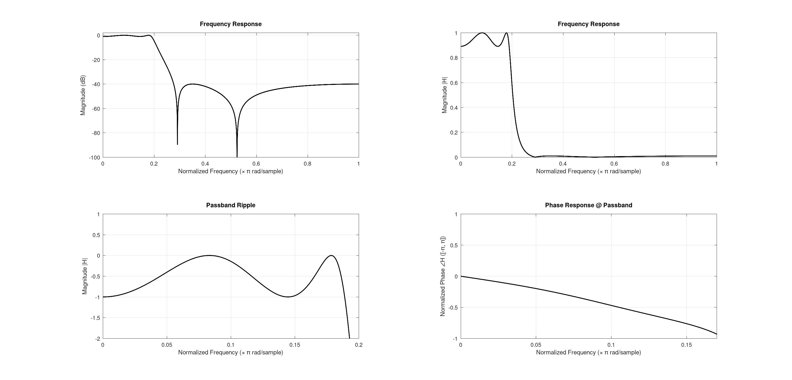
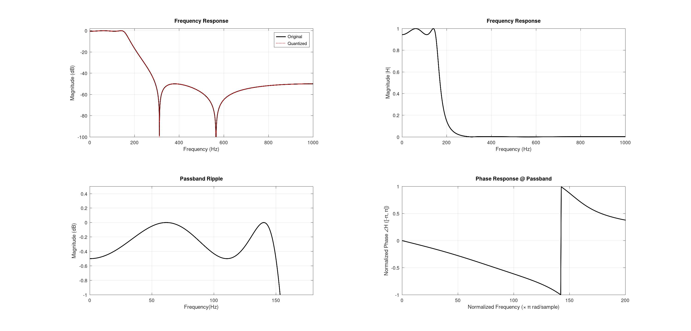

# Case Study 1: The Industrial Vibration Monitor
**Application:** Condition monitoring for a high-speed industrial motor.

**Sampling Frequency (Fs):** 2000 Hz

**Specifications:** Passband: 0–150 Hz (Rp ≤ 1 dB); stopband starts at 300 Hz (As ≥ 40 dB).

**Constraints:** The system runs on a resource-constrained 8-bit/16-bit microcontroller. Memory and instruction cycles are extremely limited. Phase distortion is completely acceptable.


# Report

## Attempt 1

Investigating the constraints, the optimal choice of filter is **Elliptic Filter**, which is an **IIR** filter. To design this filter the given requiremets are:
- Sampling Frequency: 2000Hz
- Passband Frequency: 0-150Hz
- Passband Ripple <= 1dB
- Stopband Attenutation >= 40dB
- Stopband Edge Frequency: 300Hz

### Reasoning 

The filter will be implemented in a resource constraint (8bit/16bit) device. Hence, we will not have much room for large computation. So, an **IIR** filter is the optimal choice here. Also, the design requires a small amount of passband ripple, and significant stopband attenuation. **Elliptic** filter can satisfy these requirements. Thus, the optimal choice should be an **Elliptic IIR** filter.

Due to bit limitation, we will not be able to perform **Direct Form I or II** hardware implementation. Thats why, a **Cascaded** Form structure is necessary.

Below is the code to design such filter

```m 
pkg load signal
clc; clear; close all;

% Describing filter requirements
fs = 2;
omega_p = 0.15*pi;
omega_s = 0.3*pi;
Rp = 1;
As = 40;

% Performing frequency pre-warping
T = 1/fs;
Omega_p = 2/T * tan(omega_p/2);
Omega_s = 2/T * tan(omega_s/2);

% Defining analog filter order proposed elliptic
[N, Omega_c] = ellipord(Omega_p/pi, Omega_s/pi, Rp, As,'s');

% Designing the Elliptic filter
[b_analog, a_analog] = ellip(N, Rp, As, Omega_c,'s');

% Performing Billiniar Transformation
[b, a] = bilinear(b_analog, a_analog, 1/T);

% Direct form to cascaded form
[sos, g] = tf2sos(b, a);

% Finding frequency response
nfft = 2048;
[H, omega] = freqz(b, a, nfft);
H_mag_db = 20*log10(abs(H));

H_phase = angle(H) / pi; 

% Plotting resposnes
figure;
subplot(221);
plot(omega/pi, H_mag_db, 'k', 'LineWidth', 1.8);
grid on;
ylim([-100, 2]);
title('Frequency Response');
xlabel('Normalized Frequency (\times \pi rad/sample)');
ylabel('Magnitude (dB)');

subplot(222);
plot(omega/pi, abs(H), 'k', 'LineWidth', 1.8);
grid on;
title('Frequency Response');
xlabel('Normalized Frequency (\times \pi rad/sample)');
ylabel('Magnitude |H|');

subplot(223);
plot(omega/pi, H_mag_db, 'k', 'LineWidth', 1.8);
grid on;
ylim([-2, 1]);
xlim([0 0.2]);
title('Passband Ripple');
xlabel('Normalized Frequency (\times \pi rad/sample)');
ylabel('Magnitude(dB)');

subplot(224);
plot(omega/pi, H_phase, 'k', 'LineWidth', 1.8);
grid on;
title('Phase Response @ Passband');
xlabel('Normalized Frequency (\times \pi rad/sample)');
ylabel('Normalized Phase \angleH ([-\pi, \pi])');
xlim([0, 0.17]);


% Print Result to console
fprintf('Calculated Order (N)   = %d\n', N);
fprintf('Analog Cutoff Frequency = %.4f rad/s\n', Omega_c);
disp('Direct Form Filter Coefficients');
disp('b=');
disp(b);
disp('a=');
disp(a);
disp('Cascaded Filter Coefficients(S0S), matrix of series second-order sections, one per row');
disp(sos);
disp('Filter Gain(g)');
disp(g);
```

### Results
```
Calculated Order (N)   = 4
Analog Cutoff Frequency = 0.3057 rad/s
Direct Form Filter Coefficients
b=
   0.018455  -0.019769   0.033549  -0.019769   0.018455
a=
   1.0000  -3.1043   3.9433  -2.3780   0.5737
Cascaded Filter Coefficients(S0S), matrix of series second-order sections, one per row
   1.0000   0.1492   1.0000   1.0000  -1.5379   0.6455
   1.0000  -1.2204   1.0000   1.0000  -1.5664   0.8888
Filter Gain(g)
0.018455
```
The output graphs are shown below:


### Success
The design verifies the passband ripple and stopband attenutation requirements. Also, the phase response in passband was found to be close to linear which ensures the distortionless syste, although it was not an hard requiremens.

### Issues
1. I plot all the frequencies in `radian` unit, but in practice we need to plot those frequencies in `Hz`. 
2. In the code,`m
% Defining analog filter order proposed elliptic
[N, Omega_c] = ellipord(Omega_p/pi, Omega_s/pi, Rp, As,'s');` In this section, I put `Omega/pi` as the parameters of the function `ellipord(...,'s')`. But, when `ellipord(...,'s')`, it takes frequencies in `radians/second` instead of `radians`. Hence, the implementation here was not accurate, although the result was somewhat expected.
3. I did not quantized the coefficients found from the cascaded design for `8bit/16bit` devices. 


## Attempt 2
- I solved the issues and re-design the filter. In this case, I use `ellipord()` function directly with frequencies with **Nuyquist Frequency**. The biliniar transformation is performed inherently `ellip()` function. 
- Plotted all the graphs in `Hz` unit, according to practice. 
- Quantized the SOS coefficients to be implemented on a 8bit/16bit device, and verify the quantization for minimam quantization error. 

The code is given below:
```m
pkg load signal
clc; clear; close all;

% Describing filter requirements
Fs = 2000;
fp = 150;
fs = 300;

% digital frequency normalized to Nuyquist range [0,1]
omega_p = fp/(Fs/2);
omega_s = fs/(Fs/2);
Rp = 0.5;
As = 50;

% Defining analog filter order proposed elliptic
[N, Wc] = ellipord(omega_p, omega_s, Rp, As);

% Designing the Elliptic filter
[b, a] = ellip(N, Rp, As, Wc);

% Direct form to cascaded form
[sos, g] = tf2sos(b, a);

% Coefficient quantization
factor = 13;
scale = 2^factor;

sos_quantized = round(sos * scale) / scale;

%Verifing quantization
[b_q, a_q] = sos2tf(sos_quantized, g);

% Finding frequency response
nfft = 2048;
[H, W] = freqz(b, a, nfft);
H_mag_db = 20*log10(abs(H));
H_phase = angle(H) / pi; 
[H_quant, ~] = freqz(b_q, a_q, nfft);
H_quant_mag_db = 20*log10(abs(H_quant));

% Plotting resposnes
figure;
subplot(221);
plot(W/pi*(Fs/2), H_mag_db, 'k', 'LineWidth', 1.8);
hold on;
plot(W/pi*(Fs/2), H_quant_mag_db, 'r:', 'LineWidth', 1.4);
grid on;
ylim([-100, 2]);
title('Frequency Response');
xlabel('Frequency (Hz)');
ylabel('Magnitude (dB)');
legend('Original', 'Quantized');

subplot(222);
plot(W/pi*(Fs/2), abs(H), 'k', 'LineWidth', 1.8);
grid on;
title('Frequency Response');
xlabel('Frequency (Hz)');
ylabel('Magnitude |H|');

subplot(223);
plot(W/pi*(Fs/2), H_mag_db, 'k', 'LineWidth', 1.8);
grid on;
ylim([-1, 0.5]);
xlim([0 180]);
title('Passband Ripple');
xlabel('Frequency(Hz)');
ylabel('Magnitude (dB)');

subplot(224);
plot(W/pi*(Fs/2), H_phase, 'k', 'LineWidth', 1.8);
grid on;
title('Phase Response @ Passband');
xlabel('Normalized Frequency (\times \pi rad/sample)');
ylabel('Normalized Phase \angleH ([-\pi, \pi])');
xlim([0 200]);

% Print Result to console
fprintf('Calculated Order (N)   = %d\n', N);
fprintf('Cutoff Frequency = %dHz\n', Wc*(Fs/2));
disp('Direct Form Filter Coefficients');
disp('b=');
disp(b);
disp('a=');
disp(a);
disp('Cascaded Filter Coefficients(S0S), matrix of series second-order sections, one per row');
disp(sos);
disp('Filter Gain(g)');
disp(g);
disp('Quantized Coefficients(Q2.13)');
disp(sos_quantized);
% Print quantized coefficients as integers (what you'll actually paste into C code)
disp('Integer values for C code (Q2.13 format):');
disp(round(sos * scale));
```

### Results
```
Calculated Order (N)   = 4
Cutoff Frequency = 150Hz
Direct Form Filter Coefficients
b=
   7.2677e-03  -5.1654e-03   1.1251e-02  -5.1654e-03   7.2677e-03
a=
   1.0000  -3.2364   4.1455  -2.4651   0.5724
Cascaded Filter Coefficients(S0S), matrix of series second-order sections, one per row
   1.0000   0.4051   1.0000   1.0000  -1.5814   0.6572
   1.0000  -1.1158   1.0000   1.0000  -1.6551   0.8710
Filter Gain(g)
7.2677e-03
Quantized Coefficients(Q2.13)
   1.0000   0.4050   1.0000   1.0000  -1.5814   0.6572
   1.0000  -1.1158   1.0000   1.0000  -1.6550   0.8710
Integer values for C code (Q2.13 format):
    8192    3318    8192    8192  -12955    5384
    8192   -9141    8192    8192  -13558    7135
```
The output graphs are shown below:


